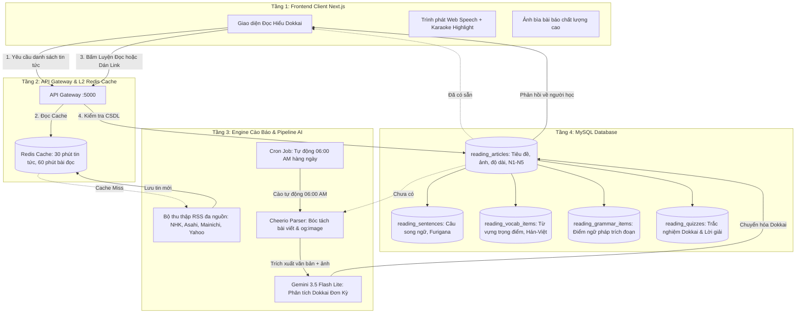

# 📰 KIẾN TRÚC & CƠ CHẾ HOẠT ĐỘNG CỦA BỘ CÀO TIN TỨC TIẾNG NHẬT DOKKAI
*(Japanese News Crawler & Interactive Dokkai Engine Architecture)*

---

## 📌 1. TỔNG QUAN & GIẢI ĐÁP CƠ CHẾ HOẠT ĐỘNG

> **Câu hỏi**: *"Cách hoạt động của cào báo này như thế nào? Mỗi ngày sẽ là 1 bài mới hay tự lưu vào cơ sở dữ liệu (CSDL)?"*

### 💡 Câu trả lời tóm tắt:
1. **Tự động lưu vĩnh viễn vào CSDL (On-Demand Auto-Persistence)**:
   - Bất cứ khi nào người dùng bấm **"Luyện Đọc"** trên một bài báo hoặc dán đường dẫn (URL) bất kỳ từ NHK / Mainichi / Asahi / Yahoo JP, hệ thống sẽ bóc tách nội dung + ảnh bài báo, phân tích qua AI và **ngay lập tức lưu trọn vẹn vào CSDL MySQL**.
   - Kể từ lần thứ 2 trở đi (hoặc bất kỳ học viên nào khác cùng học bài này), hệ thống kiểm tra thấy URL đã tồn tại trong CSDL sẽ **trả về ngay lập tức trong 5ms, hoàn toàn miễn phí và tiêu tốn 0 Token AI**.
2. **Không giới hạn 1 bài/ngày — Dòng tin cập nhật thời gian thực (Live Continuous Feeds)**:
   - Tab *"Tin tức báo chí"* tự động kết nối với hệ thống RSS của 4 hãng thông tấn hàng đầu Nhật Bản (NHK, Asahi, Mainichi, Yahoo JP) và làm mới danh sách tin mỗi **30 phút** (được đệm bằng Redis).
   - Mỗi ngày học viên luôn có từ **25 đến 40+ bài báo thời sự nóng hổi** để lựa chọn theo đúng sở thích và trình độ (N5 - N1).
3. **Bộ lập lịch tự động cào bài mỗi sáng (Daily Scheduled Cron Job)**:
   - Hệ thống được trang bị tiến trình nền (`node-cron`) chạy định kỳ vào lúc **06:00 AM mỗi sáng**.
   - Bộ lập lịch sẽ tự động chọn 3 bài báo nổi bật nhất trong ngày từ NHK và Mainichi Shimbun, cào và chuyển hóa sẵn sang cấu trúc Dokkai (tách câu song ngữ, gắn Furigana, trích xuất từ vựng & ngữ pháp, tạo trắc nghiệm) rồi lưu sẵn vào MySQL. Khi học viên mở ứng dụng vào buổi sáng, bài học mới đã sẵn sàng mà không cần chờ AI tạo.

---

## 🏛️ 2. MÔ HÌNH KIẾN TRÚC 4 TẦNG (4-TIER ARCHITECTURE)



---

## 📊 3. THIẾT KẾ CƠ SỞ DỮ LIỆU (DATABASE SCHEMA)

Toàn bộ dữ liệu bài đọc và tin tức cào được quản lý qua Prisma ORM trên MySQL:

### 3.1. Bảng `reading_articles` (Thông tin bài đọc & Ảnh bìa)
| Cột | Kiểu dữ liệu | Ý nghĩa |
| :--- | :--- | :--- |
| `id` | VARCHAR(36) | Khóa chính UUID |
| `title` | VARCHAR(255) | Tiêu đề bài báo tiếng Nhật (đã làm sạch) |
| `sourceType` | VARCHAR(50) | `NHK_NEWS`, `EXTERNAL_NEWS`, `AI_GENERATED`, `USER_TEXT` |
| `sourceUrl` | TEXT | URL gốc bài báo (dùng đối chiếu trùng lặp 0 Token) |
| `imageUrl` | TEXT | **URL ảnh bìa chất lượng cao** (`og:image` từ trang tin) |
| `level` | VARCHAR(10) | Cấp độ JLPT phù hợp (`N5`, `N4`, `N3`, `N2`, `N1`) |
| `topic` | VARCHAR(100) | Chuyên đề bài đọc (Xã hội, Công nghệ, Kinh tế, Đời sống) |
| `totalWords` | INT | Tổng số lượng ký tự tiếng Nhật |
| `isPublic` | BOOLEAN | `true` — Đưa vào Thư viện dùng chung cho cả cộng đồng |

### 3.2. Bảng quan hệ 1 - N (Chi tiết bài học)
- **`reading_sentences`**: Lưu từng câu tiếng Nhật đã căn chỉnh thứ tự, kèm bản dịch nghĩa tiếng Việt và thẻ `<ruby>Hán tự<rt>Furigana</rt></ruby>`.
- **`reading_vocab_items`**: Danh sách 5-8 từ vựng quan trọng nhất trong bài (Từ, Cách đọc Hiragana, Âm Hán Việt, Ý nghĩa).
- **`reading_grammar_items`**: Điểm ngữ pháp trọng tâm cấp độ N1-N5 xuất hiện trong bài kèm câu trích dẫn thực tế.
- **`reading_quizzes`**: Bộ 3-5 câu hỏi trắc nghiệm đọc hiểu chuẩn format đề thi JLPT (gạch chân lý do, ý chính tác giả, đối chiếu chi tiết), kèm 4 phương án lựa chọn và lời giải thích song ngữ.

---

## ⚙️ 4. NGUYÊN LÝ TRÍCH XUẤT ẢNH BÌA & XỬ LÝ ÂM THANH

### 4.1. Cơ chế bóc tách ảnh bìa bài báo (`imageUrl`)
Khi bài báo được cào từ nguồn bên ngoài qua Cheerio:
1. **Ưu tiên 1 (`og:image`)**: Trích xuất thẻ `<meta property="og:image" content="...">`. Đây là ảnh chuẩn do chính tòa soạn NHK, Mainichi, Asahi cấu hình cho mạng xã hội với độ phân giải cao nhất (1200x630 hoặc 800x450).
2. **Ưu tiên 2 (`twitter:image`)**: Trích xuất `<meta name="twitter:image" content="...">`.
3. **Ưu tiên 3 (Ảnh đại diện trong bài)**: Lấy ảnh đầu tiên nằm trong thẻ `<article img>` hoặc `.article-body img`.
4. **Fallback thông minh**: Nếu bài viết là thông cáo báo chí thuần văn bản không có ảnh, hệ thống tự động gán ảnh phong cảnh Nhật Bản theo chủ đề nguồn tin (Tokyo, Shibuya, Kyoto, Núi Phú Sĩ) để giao diện luôn trực quan, không bị vỡ bố cục.

### 4.2. Cơ chế khắc phục hiện tượng đọc lướt & chữ không sáng (Karaoke Highlight)
- **Vấn đề trước đây**: Trên trình duyệt Chromium (Windows), khi phát âm tiếng Nhật (vốn không có dấu cách giữa các từ), sự kiện `utterance.onboundary` chỉ phát duy nhất 1 lần tại ký tự số 0 rồi dừng lại tới tận dấu chấm câu. Điều này khiến cờ hiệu boundary bị kẹt, dẫn đến chữ không sáng trong suốt câu.
- **Giải pháp xử lý**:
  1. **Làm sạch văn bản TTS**: Loại bỏ toàn bộ thẻ ruby `[ふりがな]`, thẻ gạch chân `【下線】` và HTML để giọng đọc phát âm liền mạch, không bị khựng lại ở ký tự lạ.
  2. **Bộ đệm nội suy kép (Hybrid Mora-Ratio Ticker 30ms)**:
     - Ticker tính toán thời lượng thực tế của câu dựa trên số lượng phách âm (Mora):
       $$\text{realDurationSec} = \frac{\text{moraCount}}{7.0} + \text{commas} \times 0.35 + \text{periods} \times 0.5$$
     - Khi `onboundary` phát, hệ thống đồng bộ vị trí ký tự ngay lập tức.
     - Nếu sau 180ms trình duyệt không phát thêm boundary event nào (đặc thù Chromium tiếng Nhật), ticker tự động nội suy vị trí ký tự theo thời gian thực:
       $$\text{activeCharIndex} = \min(\text{length} - 1, \max(\text{lastBoundary}, \lfloor \text{progressRatio} \times \text{length} \rfloor))$$
  3. **Đảm bảo luôn có từ được sáng**: Nếu chỉ số ký tự rơi vào dấu câu cô lập (`「`, `」`, `、`, `。`), hệ thống tự động trỏ về từ vựng thực sự liền kề, giúp màu xanh karaoke luôn nổi bật và chạy mượt theo từng âm tiết phát ra.

---

## 🛠️ 5. HƯỚNG DẪN TỰ CẤU HÌNH & TÙY BIẾN

### 5.1. File mã nguồn chính
1. **`server/src/services/reading/reading.service.ts`**:
   - Chứa logic thu thập RSS: `getLatestNews()`
   - Chứa logic cào bóc tách bài báo và gọi Gemini: `crawlAndProcessArticle()`
2. **`server/src/services/reading/reading-cron.service.ts`**:
   - Bộ lập lịch tự động cào bài định kỳ bằng `node-cron`.
3. **`server/src/services/reading/reading.routes.ts`**:
   - Đường dẫn API: `GET /api/reading/news/latest`, `POST /api/reading/news/import`, `POST /api/reading/news/trigger-crawl`.
4. **`client/src/components/reading/SharedLibraryView.tsx`**:
   - Giao diện thẻ tin tức có ảnh bìa, bộ lọc cấp độ N5-N1 và ô nhập link bài báo.
5. **`client/src/components/reading/DokkaiStudyView.tsx`**:
   - Trình đọc bài viết kèm ảnh bìa cỡ lớn, audio bar và hệ thống trắc nghiệm.

### 5.2. Thay đổi giờ cào tự động hàng ngày
Trong file `server/src/services/reading/reading-cron.service.ts`:
```typescript
// Mặc định: Chạy lúc 06:00 sáng mỗi ngày
cron.schedule('0 6 * * *', async () => {
  await this.triggerDailyNewsCrawl(3); // Cào 3 bài mới nhất
});
```
- Nếu muốn chạy mỗi 6 tiếng một lần: đổi thành `'0 */6 * * *'`
- Nếu muốn cào lúc 07:30 sáng: đổi thành `'30 7 * * *'`

### 5.3. Thêm một nguồn báo tiếng Nhật mới
Trong hàm `getLatestNews()` của `reading.service.ts`, bạn chỉ cần thêm nguồn RSS vào mảng `feeds`:
```typescript
const feeds = [
  { name: 'NHK', url: 'https://www.nhk.or.jp/rss/news/cat0.xml', defaultLevel: 'N3' },
  { name: 'YAHOO', url: 'https://news.yahoo.co.jp/rss/topics/top-picks.xml', defaultLevel: 'N3' },
  { name: 'MAINICHI', url: 'https://mainichi.jp/rss/etc/mainichi-flash.rss', defaultLevel: 'N2' },
  { name: 'ASAHI', url: 'http://rss.asahi.com/rss/asahi/newsheadlines.rdf', defaultLevel: 'N2' },
  // Thêm nguồn mới ở đây (VD: Matcha Japan hoặc NHK Easy News):
  { name: 'MATCHA', url: 'https://matcha-jp.com/jp/feed', defaultLevel: 'N4' }
];
```

### 5.4. Kích hoạt cào bài thủ công qua API
Bạn có thể gọi trực tiếp lệnh API để kiểm tra chức năng cào báo bất cứ lúc nào:
```bash
curl -X POST http://localhost:5000/api/reading/news/trigger-crawl \
     -H "Content-Type: application/json" \
     -d '{"maxArticles": 2}'
```
Kết quả trả về danh sách các bài báo đã được bóc tách và lưu vào CSDL MySQL với mã trạng thái `SUCCESS`.

---

## 🛡️ 6. KIỂM SOÁT CONCURRENCY & CHỐNG PHÌNH TO CƠ SỞ DỮ LIỆU

### 6.1. Cào và lưu liên tục có làm CSDL bị phình to không? (Database Scale Analysis)

#### 🧮 Phân tích dung lượng thực tế (Toán học CSDL):
- Mỗi bài báo Dokkai đầy đủ trong MySQL bao gồm:
  - Thông tin bài báo + URL + Ảnh bìa: ~1 KB
  - ~15 câu văn song ngữ kèm Furigana (`reading_sentences`): ~3.5 KB
  - 6 mục từ vựng trọng điểm (`reading_vocab_items`): ~1.2 KB
  - 4 điểm ngữ pháp trọng tâm (`reading_grammar_items`): ~1 KB
  - 3 câu hỏi trắc nghiệm & giải thích (`reading_quizzes`): ~1.5 KB
  - **👉 Tổng dung lượng 1 bài học Dokkai hoàn chỉnh chỉ khoảng 8 KB đến 10 KB.**

#### 📈 Dự phóng tăng trưởng:
- **100 bài báo**: ~800 KB (chưa tới 1 MB).
- **1.000 bài báo**: ~8 MB (tương đương dung lượng của 2 bức ảnh chụp điện thoại).
- **3.650 bài báo** (Cào 10 bài/ngày liên tục suốt 1 năm): Chỉ tốn **~30 MB đến 35 MB**.
- Hệ quản trị MySQL hiện đại dễ dàng xử lý các bảng có kích thước hàng chục Gigabyte (hàng triệu bản ghi) với thời gian truy vấn dưới 5ms nhờ chỉ mục Index B-Tree trên cột `sourceUrl`.

#### 🧹 Cơ chế tự động dọn dẹp bài báo cũ (Retention Housekeeping Cron):
Để tránh rác CSDL và giữ cho thư viện luôn tươi mới:
- Hệ thống tích hợp hàm `cleanupStaleArticles(retentionDays = 60)` chạy tự động vào lúc **04:00 AM mỗi đêm** (`0 4 * * *`).
- **Nguyên tắc**: Tự động xóa các bài báo nguồn `EXTERNAL_NEWS` đã cào quá 60 ngày VÀ có lượt xem thấp (`viewCount <= 1`).
- Các bài học do người dùng yêu thích, bài trong giáo trình, hoặc bài có lượt học cao sẽ được giữ lại vĩnh viễn.
- **Kết quả**: Kích thước CSDL luôn được khống chế ở mức lý tưởng (chỉ khoảng 15 MB – 25 MB), không bao giờ lo đầy ổ đĩa hay giảm tốc độ truy vấn.

---

### 6.2. Cách xử lý khi nhiều người cùng nhấn cào nhiều bài báo khác nhau (Concurrency & Rate Limiting)

Khi hệ thống có nhiều học viên trực tuyến cùng lúc, hai tình huống sau sẽ phát sinh và được xử lý triệt để:

```
[Người dùng 1] ──┐
[Người dùng 2] ──┼──> [Single-Flight Lock] ──> Chỉ 1 Web Request + 1 Gemini Call ──> Trả kết quả đồng loạt cho cả 3
[Người dùng 3] ──┘      (Cùng 1 URL báo)

[User A (URL 1)] ──┐
[User B (URL 2)] ──┼──> [Concurrency Limiter] ──> Đang xử lý: Tối đa 3 luồng song song
[User C (URL 3)] ──┤    (Khác URL báo nhau)    ──> Hàng đợi FIFO (Queue): Request 4, 5 chờ 2-3s
[User D (URL 4)] ──┘
```

#### Tình huống 1: Nhiều người cùng bấm vào CÙNG MỘT bài báo thời sự (Thundering Herd Problem)
- **Cơ chế Single-Flight Request Coalescing**:
  - Khi người dùng A nhấn cào một bài báo chưa có trong CSDL, hệ thống đăng ký tác vụ đó vào một bộ nhớ đệm `crawlInFlight: Map<string, Promise<ReadingArticle>>`.
  - Nếu ngay sau đó người dùng B và C cũng bấm vào đúng bài báo đó, hệ thống **không** cào lại và **không** gọi thêm AI Gemini. Thay vào đó, cả B và C sẽ cùng gắn vào Promise đang chạy của A.
  - Khi Gemini phân tích xong, kết quả được lưu vào MySQL và trả về đồng thời cho cả A, B, C.
  - **Hiệu quả**: Tiết kiệm 100% tài nguyên CPU và Token AI thừa thãi.

#### Tình huống 2: Nhiều người bấm cào NHIỀU bài báo KHÁC NHAU cùng lúc
- **Cơ chế Bộ giới hạn song song (Concurrency Semaphore / FIFO Queue)**:
  - Nếu 10 người cùng dán 10 link báo khác nhau trong vòng vài giây, nếu cho chạy đồng loạt sẽ dễ làm cạn kiệt Outbound Sockets và vượt ngưỡng giới hạn RPM (Requests Per Minute) của Google Gemini API dẫn tới lỗi `429 Too Many Requests`.
  - Hệ thống áp dụng bộ điều phối luồng:
    - **`MAX_CONCURRENT_CRAWLS = 3`**: Tối đa chỉ có 3 bài báo được cào và phân tích AI song song.
    - Yêu cầu thứ 4 trở đi sẽ được đưa vào hàng đợi FIFO (`crawlQueue` tối đa 20 yêu cầu).
    - Mỗi bài báo AI phân tích chỉ mất khoảng **2 đến 4 giây**. Ngay khi một bài hoàn tất, yêu cầu tiếp theo trong hàng đợi sẽ được kích hoạt tức thì.
  - Nếu hàng đợi vượt quá 20 yêu cầu, hệ thống trả về thông báo lịch sự: *"Hệ thống đang phục vụ nhiều bài cào cùng lúc, vui lòng đợi trong giây lát."*

---

## 📈 7. KẾT LUẬN & ĐẶC ĐIỂM NỔI BẬT

1. **Hiệu năng & An toàn**: Kết hợp Single-Flight Coalescing và Concurrency Queue đảm bảo máy chủ luôn ổn định, không sập do tải đột biến, không vượt hạn ngạch Google Gemini API.
2. **CSDL siêu nhẹ & Bền vững**: Dữ liệu chỉ vài chục Kilobyte mỗi bài kết hợp cơ chế tự dọn dẹp lúc 04:00 AM giúp hệ thống vận hành êm ái qua nhiều năm mà không lo đầy bộ nhớ.
3. **Giao diện Dashboard Tinh gọn & Thông minh**: Bỏ hoàn toàn các thanh bộ lọc rườm rà, thay bằng Segmented Control hiện đại, bộ lọc JLPT Pills, chế độ "0s Đã lưu sẵn", thẻ tin chuẩn 16:9 với fallback chống vỡ khung và nút 1-click test linh hoạt.
4. **Trải nghiệm học đỉnh cao**: Trọn vẹn phụ đề Furigana, phát âm Tokyo chuẩn, Karaoke Mora-Ratio Ticker chống giật chữ, và trắc nghiệm tư duy chuẩn JLPT.
