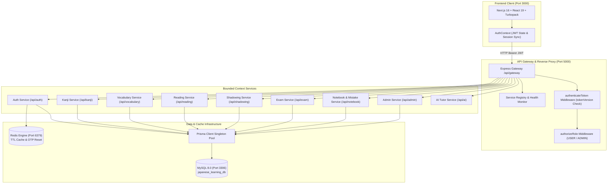
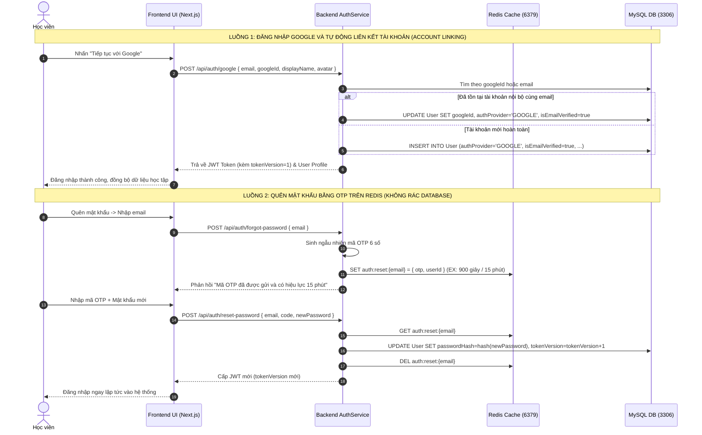

# Tài Liệu Kiến Trúc Xác Thực Đa Tầng, Bảo Mật & Triển Khai Hệ Thống NihonAI

> **Hệ sinh thái EdTech Ứng dụng AI Hỗ trợ Tự học Tiếng Nhật Toàn diện**  
> **Tác giả:** Đoàn Trần Mạnh Cường – Khoa CNTT, Trường Đại học Quy Nhơn (QNU)  
> **Mã nguồn:** [github.com/doantranmanhcuong/nihonAI](https://github.com/doantranmanhcuong/nihonAI)  
> **Phiên bản hệ thống:** 2.5.0 (Cập nhật Tháng 10/2026 - Chuẩn Enterprise & RBAC)

---

## 1. Tổng Quan Kiến Trúc Hệ Thống

Hệ thống **NihonAI** được xây dựng theo mô hình **Phân tách Hướng ngữ cảnh (Bounded Context Architecture)** với trung tâm điều phối là **API Gateway**:



### Các thành phần chính:
* **Frontend Web Client (Port 3000)**: Next.js 16, React 19, Tailwind CSS, Lucide Icons, quản lý phiên đăng nhập tập trung qua `AuthContext`.
* **API Gateway & Services (Port 5000)**: Node.js, Express, TypeScript với 9 Bounded Contexts độc lập hoàn toàn.
* **Database Layer (Port 3306)**: MySQL 8.0 lưu trữ quan hệ thực thể người dùng, đề thi, sổ tay, bài đọc qua Prisma ORM 5.22.
* **Cache & Memory Layer (Port 6379)**: Redis Server lưu trữ mã khôi phục OTP (TTL 15 phút), bộ đệm danh sách đề thi (TTL 12 giờ), và danh mục RSS.

---

## 2. Thiết Kế Mô Hình Xác Thực Đa Tầng (Hybrid Authentication)

Hệ thống kết hợp các cơ chế bảo mật cấp doanh nghiệp (Enterprise Grade):



### Chi tiết các cơ chế cốt lõi:

#### A. Liên kết Tài khoản Tự động (Third-party Account Linking)
* Khi học viên đăng ký ban đầu bằng Email/Password nhưng sau đó chọn **"Tiếp tục với Google"**, hệ thống tự động liên kết tài khoản dựa trên Email đã xác thực.
* Toàn bộ lịch sử làm bài thi JLPT, sổ tay ghi nhớ SRS và chuỗi ngày học (Streak) đều được bảo toàn nguyên vẹn.

#### B. Khôi phục Mật khẩu Tạm thời qua Redis (OTP With TTL)
* Mã OTP 6 chữ số được lưu độc quyền trên Redis với vòng đời **TTL = 15 phút (900 giây)**.
* Khi đổi mật khẩu thành công hoặc hết hạn, Redis tự động giải phóng bộ nhớ, đảm bảo CSDL MySQL không bị rác dữ liệu.

#### C. Thu hồi Phiên Đăng nhập Tức thì (Token Versioning)
* Mỗi JWT Payload mang theo trường `tokenVersion`:
  $$\text{JWT Payload} = \{ \text{userId}, \text{email}, \text{role}, \text{tokenVersion} \}$$
* Khi người dùng đổi mật khẩu hoặc đăng xuất khỏi mọi thiết bị:
  $$\text{tokenVersion} \leftarrow \text{tokenVersion} + 1$$
* Middleware `authenticateToken` sẽ lập tức từ chối mọi Token cũ mang `tokenVersion` thấp hơn giá trị hiện tại trong CSDL.

#### D. Phân Quyền Vai Trò & Bảo Vệ Cổng Quản Trị (RBAC & Admin Security)
* Hai vai trò người dùng trong hệ thống:
  * `USER`: Truy cập toàn bộ phân hệ học tập (Hán tự, Từ vựng, Ngữ pháp, Đọc hiểu, Shadowing, Thi thử, Sổ tay).
  * `ADMIN`: Quyền truy cập vào `/admin`, quản trị học viên, đổi vai trò, xem lịch sử điểm thi chi tiết, quản trị bài viết, xem nhật ký Audit Log và bật tắt chế độ bảo trì.
* Middleware `authorizeRole(['ADMIN'])` chặn đứng mọi nỗ lực truy cập trái phép của tài khoản thường.

---

## 3. Lược Đồ Dữ Liệu Thực Thể Người Dùng (Prisma Model)

Cấu trúc bảng `User` được định nghĩa trong `server/prisma/schema.prisma`:

```prisma
model User {
  id              String              @id @default(uuid())
  email           String              @unique
  firebaseUid     String?             @unique
  displayName     String?
  targetLevel     String              @default("N5")
  createdAt       DateTime            @default(now())
  updatedAt       DateTime            @updatedAt
  avatar          String?
  passwordHash    String?
  authProvider    String              @default("LOCAL")
  googleId        String?             @unique
  isEmailVerified Boolean             @default(false)
  lastLoginAt     DateTime?
  tokenVersion    Int                 @default(1)
  role            String              @default("USER")
  status          UserStatus          @default(ACTIVE)
  banReason       String?
  lastStudyDate   DateTime?
  studyStreak     Int                 @default(0)
  examAttempts    JlptExamAttempt[]
  notebookItems   NotebookItem[]
  aiAuditLogs     AiAuditLog[]
  readingQuotas   ReadingDailyQuota[]

  @@index([lastLoginAt])
  @@index([role])
  @@map("users")
}

enum UserStatus {
  ACTIVE
  BANNED
  SUSPENDED
}
```

---

## 4. Đặc Tả Danh Mục API Đầy Đủ

| STT | Phương thức | Endpoint | Yêu cầu Quyền | Mô tả chức năng |
|:---:|:---:|:---|:---:|:---|
| 1 | `POST` | `/api/auth/demo` | Public | Đăng nhập tài khoản Demo báo cáo ĐATN |
| 2 | `POST` | `/api/auth/google` | Public | Đăng nhập Google & Tự động liên kết tài khoản |
| 3 | `POST` | `/api/auth/register` | Public | Đăng ký tài khoản học viên mới |
| 4 | `POST` | `/api/auth/login` | Public | Đăng nhập tài khoản nội bộ (cấp JWT + Cookie) |
| 5 | `GET` | `/api/auth/me` | User | Lấy thông tin tài khoản hiện tại & kiểm tra phiên |
| 6 | `PUT` | `/api/auth/level` | User | Cập nhật trình độ mục tiêu JLPT (N5 $\rightarrow$ N1) |
| 7 | `POST` | `/api/auth/forgot-password` | Public | Gửi mã OTP khôi phục 6 số qua Redis |
| 8 | `POST` | `/api/auth/reset-password` | Public | Xác thực OTP và đặt mật khẩu mới |
| 9 | `POST` | `/api/auth/revoke-sessions` | User | Thu hồi phiên trên tất cả thiết bị |
| 10 | `GET` | `/api/exam/list` | Public | Danh sách đề thi mô phỏng JLPT (Redis Cache 12h) |
| 11 | `GET` | `/api/exam/:id` | Public | Chi tiết bài thi theo format Express hoặc Full |
| 12 | `POST` | `/api/exam/submit` | Optional Auth | Chấm điểm tự động thang 180, xét điểm liệt và lưu kết quả |
| 13 | `POST` | `/api/exam/ai-explain` | Optional Auth | Hỏi Trợ giảng AI giải thích câu sai trong đề thi |
| 14 | `GET` | `/api/exam/audio/:id` | Public | Stream âm thanh hội thoại nghe hiểu Choukai |
| 15 | `GET` | `/api/notebook` | User | Lấy danh sách Sổ tay & Ngân hàng câu sai |
| 16 | `POST` | `/api/notebook` | User | Thêm mục mới vào sổ tay cá nhân |
| 17 | `GET` | `/api/notebook/due` | User | Lấy danh sách thẻ đến hạn ôn tập SRS |
| 18 | `POST` | `/api/notebook/:id/review` | User | Cập nhật đánh giá chất lượng ôn tập SM-2 |
| 19 | `GET` | `/api/admin/users` | Admin | Quản lý danh sách người dùng và trạng thái |
| 20 | `PATCH` | `/api/admin/users/:id/role` | Admin | Thay đổi phân quyền tài khoản (USER $\leftrightarrow$ ADMIN) |
| 21 | `GET` | `/api/admin/users/:id/progress` | Admin | Tra cứu chi tiết điểm số các lượt thi của học viên |
| 22 | `GET` | `/api/admin/stats` | Admin | Thống kê tổng quan hệ thống (User, Exam, Vocab...) |

---

## 5. Quy Trình Cài Đặt & Triển Khai (Deployment Guide)

### 5.1. Yêu cầu Tiền đề
* **Node.js**: Phiên bản `>= 20.0.0` LTS.
* **MySQL Database**: Phiên bản `>= 8.0` trên cổng `3306`.
* **Redis Engine**: Phiên bản `>= 6.2` trên cổng `6379`.

### 5.2. Các Lệnh Khởi Chạy Tại Thư Mục `D:\cool-hopper`
```powershell
# 1. Khởi chạy Backend Server
cd D:\cool-hopper\server
npm install
npx prisma generate
npx prisma db push
npm run dev

# 2. Khởi chạy Frontend Client (Terminal mới)
cd D:\cool-hopper\client
npm install
npm run dev
```

Ứng dụng sẽ sẵn sàng phục vụ tại:
* Giao diện học viên: `http://localhost:3000`
* Bảng giám sát Gateway & Sức khỏe dịch vụ: `http://localhost:5000/api/gateway/health`
